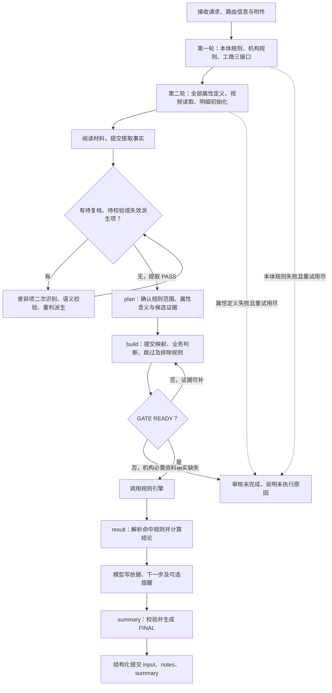

# 灵活用工企业客户准入校验：业务流程（当前 uat-script）

整理日期：2026-11-12。

来源：`prompt/uat-script` 当前主提示词、8 个 skill 正文、提取清单及运行配置。版本契约为 `admission-noshell-v0-1-1`，revision 仍为 `0.1.1`。README 包含多轮历史修订，本文按当前运行正文和数据文件整理，不把历史流程混入当前流程。

本文是业务流程说明，不是执行准入任务的指令；未调用外部业务接口，也未核验线上部署版本。

## 1. 与《v28-claude-script-业务流程.md》的主要差异

结论：业务目标和“取规则 → 提取事实 → 组装输入 → 调用引擎 → 生成摘要”的主干相同，但不能把旧文档直接当作当前目录的流程说明。

| 对比项 | v28 业务流程文档 | 当前 uat-script |
|---|---|---|
| 最终输出 | `input`、`notes`、`summary`、`summary_debug` 四个字段 | 仅 `input`、`notes`、`summary` 三个字段 |
| 提取清单 | 144 条 | 当前 JSON 实际为 **168 条**，后续以文件为准 |
| 技能拆分 | 来源说明为 7 个 skill | 当前为 **8 个**，包括独立的业务分类 skill |
| 规则来源 | 主流程只查询本体规则；机构规则未纳入显式查询 | 同时查询本体规则与机构自定义规则，合并输入依赖 |
| 机构规则缺少输入 | 主要靠固定传企业名称防止漏跑 | 参与审核的机构规则引用键必须有证据并进入 input；缺失时阻断引擎 |
| 审核门禁 | 独立审核 A；摘要走台账终结或审核 B | 取消独立审核 A/B；由提取复核、build 门禁、summary 校验承接 |
| 材料复核 | 审核退回后修正，最多两轮 | 工商与原件 13 项比对；差异项二次识别；带 verify 的条目逐项语义校验 |
| 业务分类 | 旧文档没有完整的语义分类阶段 | 按实际业务语义对照实时选项单选；最高把握超过 50% 才提交 |
| 固定输入 | 三个 ID 加 `Employer.employer_name` | 四类标识映射为五个预设键，另加用工场景；机构规则原表达式引用键还须单独补齐 |
| 整体结论 | 不给整体准入结论 | 脚本按命中规则的处置级别计算结论，模型不得自行改判 |
| 摘要范围与格式 | 覆盖已判定的 true/false 规则，按业务类别分组，区分 T/F/U | 以命中规则为依据，固定“结论 / 依据 / 下一步”，有事项再加“注意” |
| 开户账号 | 仅保留位数与前后四位 | 提取明细完整抄录；无法读全则整条保留未知 |
| 工商同级冲突 | 描述为按 D/B/T 取首个成功来源并记录冲突 | 无冲突才按 D/B/T 优先；同一事实冲突则该项置空、记 R09 和双方原值 |
| 重试与收尾 | 重点限制审核及引擎重试 | 另加结构化提交错误的有限恢复；摘要多次不合格由脚本兜底收尾 |

## 2. 业务目标与边界

对一家申报的灵活用工企业客户完成三件事：

1. 从本次请求、可读附件、视频和工商接口提取有证据的事实，形成完整提取明细。
2. 根据本体规则、机构自定义规则和实时属性定义组装 input，真实调用规则引擎。
3. 输出 input、notes 和面向申请企业经办人的中文摘要，说明结论、依据及下一步。

准确优先；未知不以 false、0 或其他占位值替代。提取清单每项必须有值与来源，或者有未提取原因。结果类属性不作为输入事实填写；整体结论由脚本转述规则结果。流程不执行签约、开通、结算、拉黑等业务操作。

## 3. 总流程图

图中“提取 PASS”只说明提取及校验完成，不表示材料齐全或准入通过。机构规则查询失败可降级继续；取得机构规则后，其参与审核所需的输入缺失则阻断。

## 4. 六个业务阶段

### 阶段一：取得规则与外部数据

第一轮查询：

- 本体规则：原样使用网关 requestId、domain、scene，有分页则取全。
- 机构自定义规则：仅以请求 hrInstId 查询；请求未提供时不查并记录原因。
- 工商三接口：有申报名称或信用代码时，D、B、T 三接口各查一次；优先申报信用代码，其次申报名称。

第二轮取得全部对象的属性定义，查询 input 为 `{}`，不带 name。规则查询与属性查询不能同轮并行。

完整工具返回由平台落盘，脚本使用返回路径读取。规则需合并本体规则文件和机构规则文件；机构规则表达式中的企业名称、项目内容等属性是实际输入依赖，不只是关键词提示。

### 阶段二：盘点材料并提取事实

`detail.py init` 预填请求字段、工商字段、未提供材料的整组原因，以及脚本能够计算的派生项。模型按待填清单阅读材料，再通过 fill 提交事实及证据。

当前清单共 168 条：

| 分组 | 条数 | 主要内容 |
|---|---:|---|
| 请求参数 | 13 | 企业及需求标识、名称、项目、交付要求、岗位、附件盘点等 |
| 营业执照 | 25 | 名称、类型、信用代码、成立日期、营业期限起止、法人、地址、范围、资本、影像与章等 |
| 法人身份证 | 14 | 正反面、姓名、有效期、影像要求等；不抄身份证号码 |
| 开户凭证 | 11 | 户名、账户性质、发证机关、法人、银行、完整账号、核准号及影像判断 |
| 办公场所视频 | 10 | 起拍位置、连续性、工位电脑人员、招牌、物理造假证据等 |
| 业务场景照片 | 6 | 张数、画面、与任务及交付要求的关系、可见疑点 |
| 租赁合同 | 13 | 材料类型、承租方、地址、租期、双方签章、鲜章及章载名称等 |
| 补充材料 | 39 | 发票、上下游合同、社保、完税、无欠税证明、官网或公众号等 |
| 工商 | 37 | 三接口事实、调用口径及与材料的比较等 |
| 合计 | **168** | 每条都须有取值或明确原因 |

提取口径：

- 以实际可见内容判断材料是否可读，日志中的 `[unknown]` 不代表不可读。
- 名称逐字照抄，保留错字。开户名即使与工商一致，也要核对实际字形。
- 成立日期只读本栏；清楚空白或缺栏记 null/R03，模糊、裁切记 null/R06。营业期限、发证日和工商日期不能补入。
- 营业期限开始和结束分别提取；“长期”不编造截止日。
- 开户账号在提取明细中完整抄录；看不清任一位时不猜、不补全。
- 章的存在、颜色、主体名称分别判断。有章不等于有红色鲜章，彩色或有章不证明真实。
- 已确认的缺栏、名称错字要用于同材料异常检查；尚不能定性时保留未知并建议人工核实，不能直接判伪造，也不能写未见异常。
- 工商同一事实无冲突时按 D、B、T 取首个成功来源；接口之间冲突则该事实留空并记录双方原值，不裁决。
- 视频使用固定观察问题，每个视频最多两次尝试。招牌不同、剪辑、无人或推测性的 AI 生成描述，不能推出场所虚构。

最终明细行记录为 `Y｜来源｜原文证据` 或 `N｜原因码｜具体原因`；模型提交时不自行加 Y/N 前缀，由脚本生成。

### 阶段三：材料比对与提取复核

当前流程用复核和脚本检查承接质量门禁，没有独立审核 A/B。

1. **工商与原件 13 项比对**：覆盖执照主要栏位、身份证姓名、开户户名及法人、租赁承租方和注册资本等。任一侧无值则不比较。
2. **差异项二次识别**：脚本列出 RECHECK_ITEM，模型回看对应原件栏位，每项复核一次。确认仍不同则保留原件并记冲突；两次识别不同且无法确认则置未知。工商值不能直接覆盖原件。
3. **语义校验**：全部取值完成后，对清单带 verify 的条目逐项校验。当前有 9 项；不符时可重新取值一次，仍不符则置未知。
4. **派生失效检查**：源事实修改后，脚本重算其负责的派生项；模型提交的派生项若被标为 STALE，必须重新判断。

待填、待复核、待校验和失效派生项全部处理后才能 PASS。已确认成立日期空栏可完成来源校验，同时保留缺口并在摘要提醒。

### 阶段四：确定规则范围并组装输入

先运行 plan 查看实时属性含义、枚举选项、规则条件及已有事实。模型判断规则是否与本次客户准入有关，明确无关的提交排除原因；拿不准则保留。

允许进入 input 的范围为：

> 相关本体规则引用键与实时属性定义的交集，加参与审核的机构规则引用键，再加预设键；每个实际值均须有证据。

| 预设来源 | 当前传入键 |
|---|---|
| entpId | `Employer.employer_id` |
| entpName | `Employer.enterprise_name` |
| rqId | `Demand.demand_id` |
| hrInstId | `LaborAgency.agency_id`、`Agency.agency_id`，两者同值 |
| 项目内容及交付要求 | `Employer.usage_scenario`：有枚举按语义单选，无枚举才自动取项目原文 |

这里“四个标识”指四类请求值，其中企业名称也计入；机构 ID 对应两个键。机构规则若另引用 `Employer.employer_name`、`Project.project_name`，还须按表达式含义分别映射，不能只传近义的预设键。

模型通过三类操作提交组装决定：同义原文用 map；综合业务判断或枚举选择用 set，并列依据；确实不能填的键用 skip 说明原因。

业务分类需先理解人员实际做什么、提供什么、如何计酬、在哪里作业，再对照实时选项单选，不按敏感字词或固定类别顺序判断。最高把握超过 50% 才选；无法辨识则保留未知。一般类也需要正面理由，不能因没有敏感词就选。

本版明确的主体资格口径：分公司、合伙企业不具备独立用工主体资格。该事实须按属性实际含义提交否定值；排除这两类不自动证明具备资格。

门禁分两类：

- **阻断项**：未完成提取复核、validate 未通过、CHECK/ERR、机构规则必填输入缺失。机构规则键即使未出现在属性定义中，也须有证据并传入。
- **提示项**：UNDECIDED、TYPE_DROPPED、ENUM_DROPPED、NEED_VALUE 等，按原因登记后不单独阻断。最终打印 `GATE: READY` 才可调用引擎，打印后直接进入调用。

### 阶段五：执行规则引擎

以最近一次 build 输出的 INPUT 原样调用 `mcp_run_process`；该轮不同时写文件或运行脚本。

正常只调用一次。部分定义缺失、事实少、大量 skip 或规则命中，都不能成为跳过或重复调用的理由。机构规则必填输入缺失仍按前述门禁处理。

仅真实调用错误、明确编码或日期格式问题等允许修正后最多再调一次。即使 code=0，若规则列表为 null 且存在 failures，仍视为执行失败；明确点名缺少输入键时，可按真实含义补该键并重试一次，不能凭旧版本猜键。

### 阶段六：生成客户摘要并提交

`combine.py result` 从引擎返回提取命中规则，排除已认定与准入无关的规则，再按 riskMeasure 计算结论：

> 拦截 > 建议拦截 > 转人工 > 通过，取命中规则中最严一级。

只有与配置级别逐字一致的处置值进入计算。有已判定规则但没有命中时为通过；没有已判定规则，或命中规则的级别全部无法识别时，暂无结论。全部 skip 不能给通过。

摘要结构如下：

| 段落 | 生成方式与内容 |
|---|---|
| 结论 | 脚本生成，模型不得放宽或加严 |
| 依据 | 模型围绕结论级别的命中规则说明要求、触发资料及证据边界；通过级只写有原文支撑的材料事实 |
| 下一步 | 模型写可操作事项；其余非通过级别的命中规则也要覆盖；通过级由脚本固定生成 |
| 注意（有事项时） | 脚本汇总冲突、附件缺口、清单提醒等；可加入模型最多 3 条有依据的参考分析 |

摘要面向申请企业经办人，不出现规则 ID、属性变量、清单编号、原因码等技术信息。模型草稿内部的 ruleIds 用于校验，不展示给客户。

实际命中关键词来自引擎返回的 hit，脚本把它与规则业务说明拼句写入摘要，不从表达式猜关键词。触发条件不足以证明规则说明中的严重事实时，应明确证据边界，不能把名称关键词命中写成已经确认违法犯罪。

`combine.py summary` 校验后生成 FINAL 和最终文件；GenerateStructuredOutput 单独调用一次，原样提交 FINAL 中的三个字段，不附加 summary_debug 或 extractionReport。

## 5. notes 与异常处理

notes 固定为五个字符串数组：

| 数组 | 内容 |
|---|---|
| unresolvedProperties | 脚本汇总未提取条目与未填属性、原因码及原因 |
| notFoundInDefinition | 脚本登记规则引用但定义未返回的普通键；机构规则必需键另受必填门禁约束 |
| conflicts | 材料及外部来源的冲突、视频存疑观察；脚本已有的工商比对不重复登记 |
| unreadMaterials | 已提供但实际无法读取的材料、具体原因及视频尝试次数等 |
| toolIssues | 实际工具错误、定义与规则含义冲突、日期基准回退、失败或重试等 |

| 异常 | 处理 |
|---|---|
| 路由缺失、技能缺失或版本不符、脚本工具不可用 | 不发残缺引擎请求；保留已确认标识并说明实际错误 |
| 本体规则或属性定义工具整体失败 | 原参数真实重试一次；仍失败则审核未完成，说明引擎未执行 |
| 机构规则查询失败或返回为空 | 重试一次；仍失败记录问题，仅使用本体规则继续 |
| 机构规则已取得，但参与审核的必需输入确实无来源 | 不编造、不调用引擎，说明机构自定义规则所需资料不足 |
| 视频读取失败 | 每视频最多两次尝试；仍失败保留未知，不能用照片或合同替代 |
| init/fill/recheck/verify/build 的结构化提交连续两次语法错误 | 停止重试，不调用引擎；记录错误并提交审核未完成。修格式不得顺便改事实 |
| 引擎执行失败 | 如实说明“规则引擎执行失败，无可用规则结果”，不能写全未命中或通过 |
| 引擎成功但全部 skip | 暂无结论，不给通过 |
| 摘要内容校验被拒 | 只改点名项；第三次提交脚本丢弃不合格项并补齐。连续第二次语法错误由脚本兜底生成 |
| 摘要仍失败或引擎结果不完整 | 说明引擎已执行、摘要未完成，保留成功调用的输入快照 |

## 6. 角色与留存产物

| 角色 | 职责 |
|---|---|
| 主 Agent | 读材料、复核识别、确定规则范围、判断映射与分类、写摘要草稿 |
| detail.py | 初始化、合并提取、自动派生、工商比对、记录二次识别与语义校验 |
| combine.py | 规划、组装校验、调用前门禁、解析引擎返回、计算结论、校验并渲染摘要 |
| 规则引擎 | 唯一规则判定来源 |
| 结构化输出工具 | 提交最终 input、notes、summary |

核心产物留在 `work/<requestId>/`：

- `input-extract-detail.json`：全量提取明细及来源。
- `input-combine.json`：规则范围、属性映射、未填原因及引擎输入。
- `key-map.json`：模型提交并持久化的映射决定。
- `hit-rules.json`：命中规则明细及后续摘要依据。
- `final-output.json`：最终三个字段的输出。

## 7. 核对依据

- [当前主提示词](uat-script/主提示词_v0-1-1_编排版.md)：整体契约、执行顺序、门禁和最终三字段。
- [发现规则与属性](uat-script/skills/admission-v0-1-1-discover/SKILL.md)：机构规则、输入范围和预设标识。
- [提取清单](uat-script/skills/admission-v0-1-1-catalog/extract-items-checked.json)：168 条的实际统计来源。
- [清单与复核要求](uat-script/skills/admission-v0-1-1-catalog/SKILL.md)：原因码、recheck、verify 和账号提取。
- [材料取值](uat-script/skills/admission-v0-1-1-materials/SKILL.md)、[视频取值](uat-script/skills/admission-v0-1-1-video/SKILL.md)：原件事实与证据边界。
- [事实与派生](uat-script/skills/admission-v0-1-1-facts/SKILL.md)、[语义分类](uat-script/skills/admission-v0-1-1-category/SKILL.md)、[工商口径](uat-script/skills/admission-v0-1-1-business/SKILL.md)：映射、分类、主体资格及来源冲突处理。
- [引擎与输出](uat-script/skills/admission-v0-1-1-output/SKILL.md)、[结论配置](uat-script/skills/admission-v0-1-1-catalog/scripts/combine_config.json)、[预设键配置](uat-script/skills/admission-v0-1-1-catalog/scripts/run_process_required.json)：取消独立审核、四级结论及输出生成。

旧文档对比来源：`/Users/duanfa/Documents/本体提示词结构/v28-claude-script-业务流程.md`。本次比较针对这份旧流程摘要，未逐文件比较其背后的完整 v28 源码目录。
